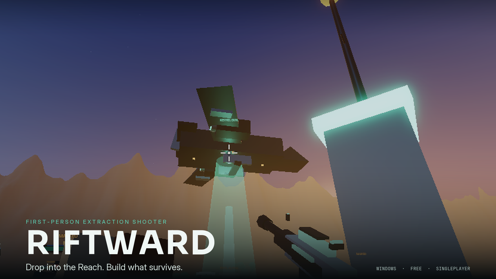
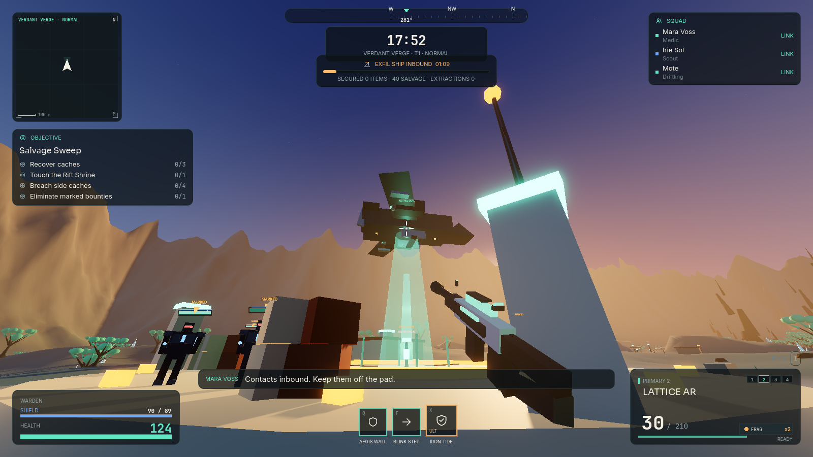
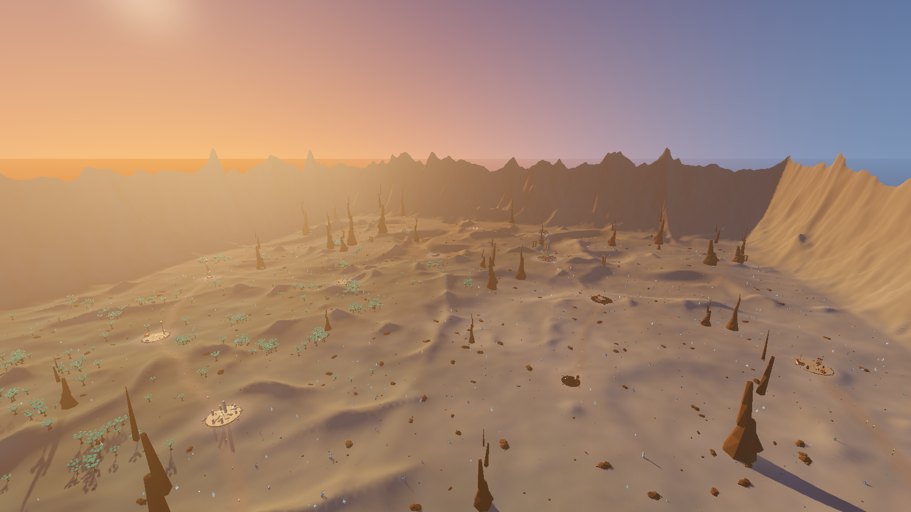
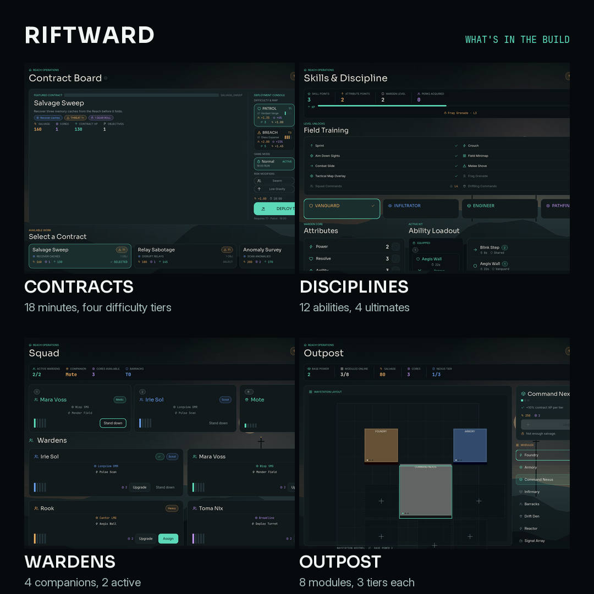

<div align="center">

# RIFTWARD

**Drop into the Reach. Build what survives.**

A single-player, first-person extraction shooter built in **Godot 4.7.2**.

[**Play free on itch.io**](https://r48n34.itch.io/riftward) · [Features](docs/FEATURES.md) · [Build from source](#build-from-source) · [License](#license)

[](https://github.com/r48n34/riftward/actions/workflows/tests.yml)
[](LICENSE)

[](https://r48n34.itch.io/riftward)

</div>

## The game

Drop into a seeded alien frontier with a loadout you can afford to lose. Take contracts, loot what you
can carry, fight three hostile factions, and get back to the dropship before the Collapse swallows the
map. What you bring home rebuilds Waystation Kestrel. What you leave behind stays lost.

- **18 minutes, one dropship.** Runs are on a clock, and extraction means holding an open pad for
  75 seconds while the map closes in around you.
- **A frontier that reshuffles.** Three biomes, 16–20 points of interest, roads and outposts, rebuilt
  from a seed on every drop.
- **Three factions to fight.** 14 enemy archetypes, 6 elites and 3 bosses — weak points, cover, strafes
  and telegraphed attacks.
- **A squad and a home.** Recruit four Warden companions and three Driftling pets, then spend what you
  extract on an eight-module outpost that persists between runs.

## Play

### itch.io (easiest)

**[r48n34.itch.io/riftward](https://r48n34.itch.io/riftward)** — free Windows download, about 40 MB.

Unzip it anywhere, keep `RIFTWARD.exe` and `RIFTWARD.pck` together, and run the executable.

*Windows 10/11 64-bit · DirectX 12 GPU · 4 GB RAM · ~150 MB disk*

### Build from source

You need **Godot 4.7.2** (standard build, not .NET).

```powershell
# one click
RIFTWARD.cmd

# or from a terminal
& "C:\path\to\Godot_v4.7.2-stable_win64.exe" --path .
```

The launcher finds Godot via `GODOT_BIN`, common install folders, or `Downloads`. You can also open
`project.godot` in the editor and press **F5**.

### Package a standalone .exe

```powershell
BUILD.cmd
```

Writes `release/windows/RIFTWARD.exe` + `RIFTWARD.pck` and a checksummed zip. This needs Godot's export
templates — see [packaging notes](docs/TECHNICAL.md#15-packaging).

## Screenshots







## Features

| | |
|---|---|
| **World** | Seeded 1.8 km frontier, 3 biomes, 16–20 POIs, 4 map moods |
| **Combat** | 10 weapons, 4 weapon slots, 12 abilities, 4 ultimates, 16 perks |
| **Enemies** | 14 archetypes, 6 elites, 3 bosses across 3 factions |
| **Squad** | 4 Warden companions (2 active), 3 Driftling pets |
| **Progression** | Levels 1–30, 4 disciplines, gear with rarities and affixes |
| **Outpost** | 8 modules × 3 tiers, persistent between runs |

Full inventory: [docs/FEATURES.md](docs/FEATURES.md).

## Controls

| Action | Key | Action | Key |
|---|---|---|---|
| Move | `WASD` | Fire / aim | `LMB` / `RMB` |
| Look | Mouse | Reload | `R` |
| Sprint | `Shift` | Interact | `E` |
| Crouch | `Ctrl` / `C` | Abilities | `Q` / `F` |
| Jump | `Space` | Ultimate | `X` |
| Melee | `V` | Grenade | `G` |
| Inventory | `I` | Map | `M` |
| Call extraction | `E` / `H` | Pause | `Esc` |

Gamepad is supported and every action is rebindable in **Settings → Controls**. Full table:
[docs/FEATURES.md#controls](docs/FEATURES.md#controls).

## Development

```powershell
tests\run_all.ps1     # all 10 headless suites
```

```
autoload/    App, ContentDB, ProfileState, RunState, EventBus, AudioDirector
features/    content, player, weapons, abilities, combat, world, ai, companions, run, loot
ui/          theme, factory, HUD, 13 screens
assets/      fonts (OFL), SVG icons, world shaders
tools/       launcher, export, packaging, store and promo art
tests/       10 headless suites and artifacts
docs/        design, technical, QA, publishing
```

More: [design](docs/DESIGN.md) · [architecture](docs/TECHNICAL.md) · [QA report](docs/QA_REPORT.md) ·
[build plan and status](docs/BUILD_PLAN.md) · [world API](features/world/WORLD_API.md) ·
[contributing](CONTRIBUTING.md)

## Status

In development, single-player and offline.

- No co-op, PvP or online play.
- No mid-run save — quitting during a deployment abandons that run.
- The build is unsigned, so Windows SmartScreen may warn on first launch
  (*More info → Run anyway*).
- A browser version would need a port, not an export: see [docs/WEB_PORT.md](docs/WEB_PORT.md).

What is done and what is planned: [docs/BUILD_PLAN.md](docs/BUILD_PLAN.md).

## License

RIFTWARD is free software under the **GNU General Public License v3.0** (or later). See
[LICENSE](LICENSE). Third-party components — Godot Engine (MIT) and the Sora, Inter and JetBrains Mono
typefaces (SIL OFL 1.1) — are listed in [docs/THIRD_PARTY_NOTICES.md](docs/THIRD_PARTY_NOTICES.md).

If you redistribute a build, GPL-3.0 requires the corresponding source; link back to this repository.

## Credits

All geometry, materials, effects and audio are generated procedurally — no external models, textures or
paid assets. Screenshots and promo art are composed from live in-engine captures.

## Built with

This game was built heavily with AI assistance:

- **DeepSeek Harness** — the agentic development environment used to write, test, review and package the
  project.
- **DeepSeek V4.1 Flash** — the model behind that work: gameplay systems, UI, procedural content, tooling
  and documentation.
- **Godot 4.7.2** — engine, Forward+ renderer, Jolt physics and the Windows export pipeline.

Design direction and final judgement were human; the implementation, test suites and documentation were
produced in that collaboration. The same disclosure appears on the
[itch.io page](https://r48n34.itch.io/riftward).
